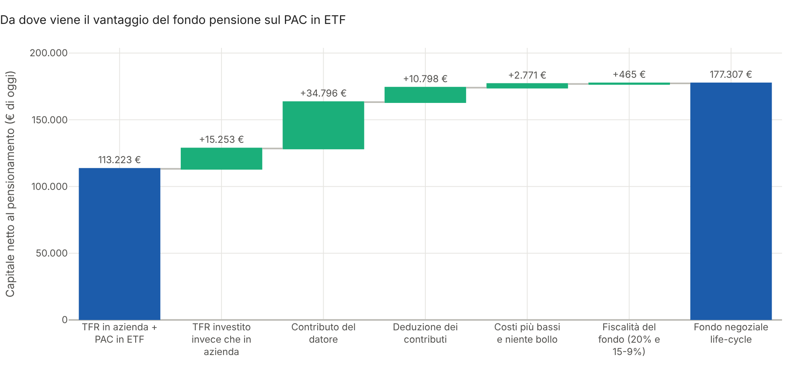
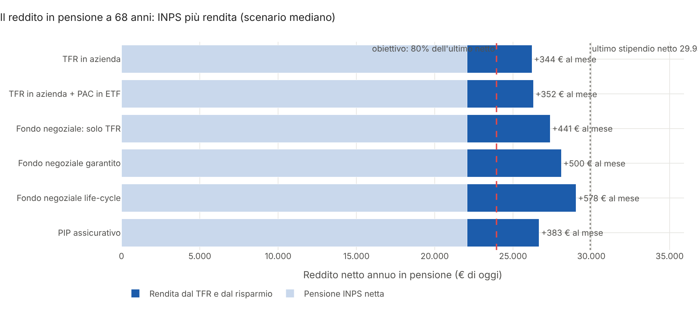
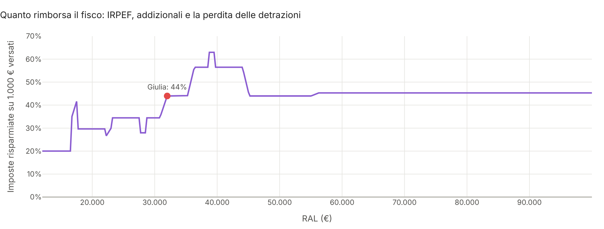
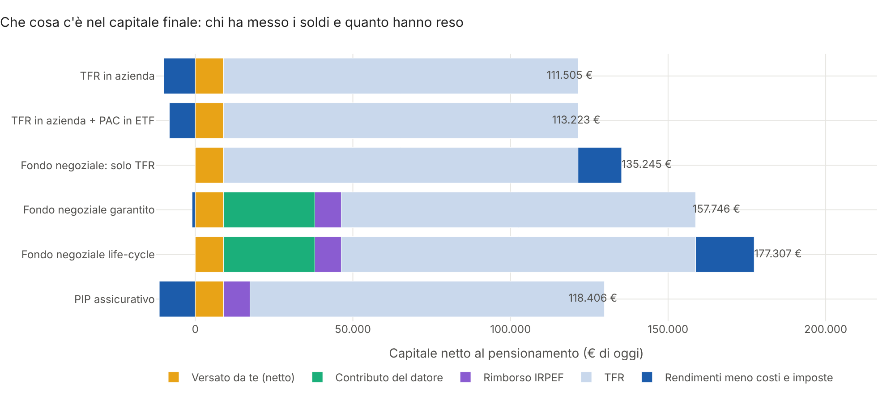
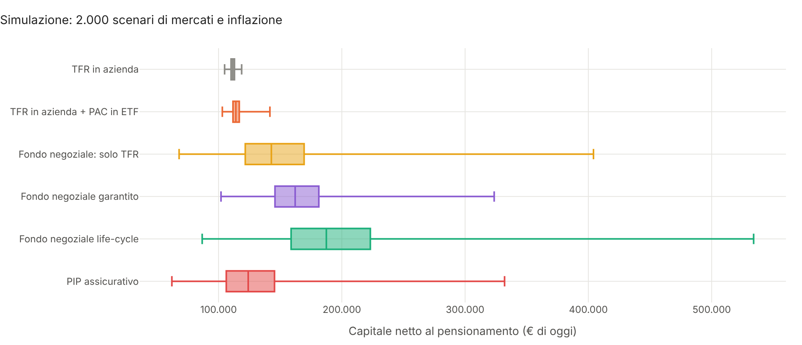
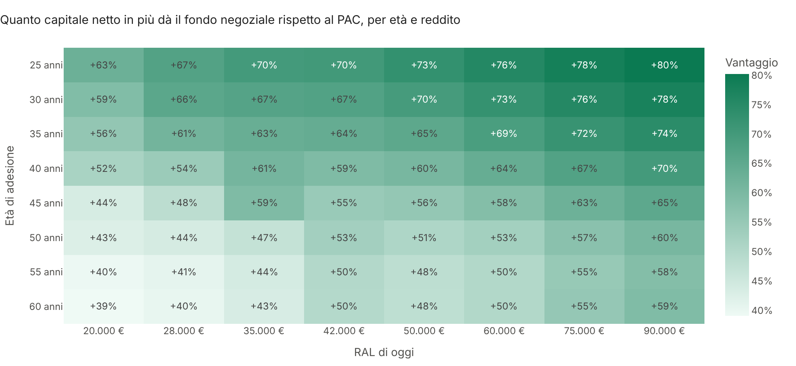
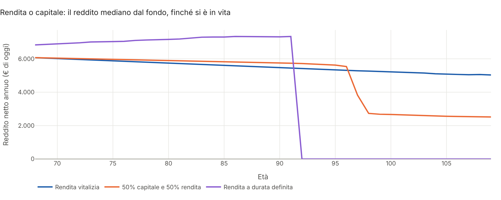

# Previdenza complementare

**TFR in azienda, fondo pensione o PAC in ETF? Un simulatore in Python con le regole italiane del 2026: la pensione
pubblica con il sistema contributivo e il gap da coprire, la deducibilità dei contributi fino a 5.300 €, la
tassazione dal 15% al 9%, il contributo del datore, i costi di fondi negoziali, PIP ed ETF, una simulazione Monte
Carlo e il confronto tra rendita vitalizia, capitale e rendita a durata definita.**

Il dibattito «fondo pensione o ETF?» di solito confronta i rendimenti. È il confronto sbagliato: un fondo negoziale e
un PAC in ETF con la stessa asset allocation rendono quasi lo stesso, e dopo le imposte la differenza è di poche
centinaia di euro. Il vantaggio del fondo viene da tre cose che un ETF non può dare: il **contributo del datore**, che
esiste solo dentro il fondo di categoria, il **TFR investito** invece che rivalutato in azienda e il **rimborso
IRPEF** sui contributi. Il progetto risponde alle domande che un consulente si pone con un lavoratore dipendente:
**quanto prenderò di pensione pubblica e quanto mi mancherà? Dove conviene mettere il TFR? Quanto mi costa davvero
aderire, dopo il rimborso fiscale? Da dove viene il vantaggio, euro per euro? E alla fine, rendita o capitale?** Il
risultato è un **report HTML interattivo** per il lavoratore.



## Cosa fa

| Area | Contenuto |
|---|---|
| **Pensione pubblica** | Sistema contributivo: 33% della retribuzione, montante rivalutato con la crescita del PIL, coefficienti di trasformazione 2025-2026 per età (interpolati) e ridotti nel tempo con la speranza di vita, densità contributiva; pensione netta con IRPEF e detrazioni per i pensionati; tasso di sostituzione e **gap** rispetto a un obiettivo sull'ultimo stipendio netto; sensibilità a PIL ed età di uscita |
| **Fisco del lavoratore** | IRPEF 2026 (23%, 33%, 43%), detrazioni per lavoro dipendente, ulteriore detrazione e somma del cuneo fiscale, trattamento integrativo, addizionali: il **rimborso effettivo** della deduzione, che include le detrazioni che si perdono al crescere del reddito |
| **TFR in azienda** | Quota del 6,91%, rivalutazione dell'1,5% più il 75% dell'inflazione con l'imposta del 17%, tassazione separata all'aliquota media del reddito di riferimento (art. 19 TUIR), anticipazione fino al 70% dopo 8 anni |
| **Fondo pensione** | TFR, contributo del lavoratore e del datore; **deducibilità fino a 5.300 €** (L. 199/2025) sulla somma di lavoratore e datore, contributi non dedotti esenti all'uscita; rendimenti tassati al 20% ogni anno (12,5% sui titoli di Stato) con il riporto dei risultati negativi; **aliquota all'uscita dal 15% al 9%**; anticipazioni per spese sanitarie, prima casa e altre esigenze con le loro aliquote |
| **Strumenti** | Fondo negoziale life-cycle e garantito (con la restituzione dei versamenti), PIP, PAC in ETF (TER, commissioni, bollo dello 0,2%, 26% sulle plusvalenze alla vendita), conto deposito; comparti e percorsi life-cycle configurabili |
| **Confronto** | Tutte le strategie a **parità di sforzo netto**: ogni anno il lavoratore mette di tasca propria la stessa somma, che nel fondo è il contributo meno il rimborso IRPEF |
| **Scomposizione** | Dal PAC al fondo una differenza alla volta: TFR investito, contributo del datore, deduzione, costi e bollo, regime fiscale |
| **Mappa** | Il vantaggio del fondo sul PAC per età di adesione e reddito |
| **Simulazione** | Monte Carlo con rendimenti lognormali correlati di azioni e obbligazioni e inflazione AR(1), che muove anche la rivalutazione del TFR: distribuzione del capitale netto e probabilità che una strategia batta l'altra |
| **Prestazione** | Rendita vitalizia (Gompertz calibrata sulla speranza di vita, tavole selezionate degli assicurati, caricamento, rivalutazione), capitale gestito in proprio con prelievi, **rendita a durata definita** introdotta nel 2026: reddito, probabilità di restare senza capitale da vivi, eredità |
| **Report** | HTML in italiano con 9 grafici interattivi Plotly e le tabelle di pensione, regole, confronto, scomposizione, simulazione e prestazione |

Tutto è scritto da zero su `numpy` e `pandas`, così ogni regola è leggibile e verificabile. Grafici `plotly`, report
`jinja2`.

## Avvio rapido

```bash
git clone https://github.com/Torraf-MI/previdenza-complementare.git
cd previdenza-complementare
pip install -e ".[png]"

# Report del caso dimostrativo (un paio di secondi con 2.000 scenari)
previdenza-complementare --demo

# Senza la simulazione Monte Carlo
previdenza-complementare --demo --veloce

# Un lavoratore descritto in un file JSON, con i grafici anche in PNG
previdenza-complementare --config esempi/giulia.json --grafici output/img

# Pensione a 70 anni invece che a 68; report utilizzabile senza rete
previdenza-complementare --demo --eta-pensione 70 --offline
```

Il report viene salvato in `output/report.html`. Un esempio già generato:
[`docs/report_esempio.html`](docs/report_esempio.html).

Il file JSON ([`esempi/giulia.json`](esempi/giulia.json)) descrive il lavoratore, il contratto, le ipotesi di mercato
e, se si vuole, strategie e anticipazioni proprie:

```json
"lavoratore": {"nome": "Giulia Conti", "eta": 33, "ral": 32000, "eta_pensione": 68, "sesso": "F",
               "anni_contributi": 6, "tfr_pregresso": 12500, "crescita_reale": 0.02, "densita_contributiva": 0.9},
"contributo_lavoratore": 0.012,
"contributo_datore": 0.02,
"costi": {"fondo_negoziale": 0.003, "pip": 0.019, "etf": 0.002},
"anticipazioni": [{"eta": 40, "importo": 25000, "tipo": "prima_casa"}]
```

Senza la voce `strategie` si confrontano le sei strategie standard. Una strategia propria indica dove va il TFR
(`azienda` o `fondo`), il fondo e il risparmio libero (`negoziale`, `garantito`, `pip`, `etf`, `deposito` o un veicolo
con comparto, costi e regime fiscale) e i contributi in percentuale della retribuzione.

## Uso come libreria

```python
from previdenza_complementare import Configurazione, Lavoratore, aliquota_prestazione, analizza, risparmio_deduzione

aliquota_prestazione(35)                 # 0,09: dopo 35 anni di adesione
risparmio_deduzione(40_000, 1_000)       # 565 €: 33% + detrazioni perse + addizionali

marco = Lavoratore("Marco Neri", eta=45, ral=48_000, eta_pensione=67, sesso="M", anni_contributi=20)
marco.pensione_inps()["sostituzione_netta"]   # 0,85

a = analizza(Configurazione(marco, contributo_lavoratore=0.01, contributo_datore=0.015))
a.tabella()          # capitale netto, costi, imposte e rendita per strategia
a.scomposizione      # da dove viene il vantaggio del fondo
```

Esempio completo in [`examples/esempio.py`](examples/esempio.py). Il motore di una singola strategia è
`simula(strategia, lavoratore, scenari, budget, anticipazioni)`.

## Risultati sull'esempio dimostrativo

Il caso è di fantasia ma tipico. Giulia Conti ha 33 anni, è impiegata con una RAL di 32.000 € e lavora da sei anni;
il TFR maturato finora (12.500 €) è rimasto in azienda. Il suo contratto prevede un fondo negoziale: se lei versa
l'1,2% della retribuzione, il datore aggiunge il 2%. Andrà in pensione a 68 anni. Gli importi sono in euro di oggi.

**La pensione pubblica copre il 74% dell'ultimo stipendio netto.** Con 37,5 anni di contributi (una densità del 90%
negli anni futuri, per tenere conto di pause e part-time), una crescita reale del PIL dello 0,8% e un coefficiente di
trasformazione che a 68 anni scende al 5,05%, Giulia prenderebbe 22.077 € netti l'anno, 1.698 € al mese su tredici
mensilità. Per arrivare all'80% dell'ultimo netto mancano 1.871 € l'anno. La stima è fragile: con un PIL allo 0,3% e
l'uscita a 67 anni il tasso scende al 64%; ogni anno di lavoro in più vale circa quattro punti.



**Aderire costa a Giulia 215 € l'anno.** Versare l'1,2% vuol dire 384 € lordi, ma il 44% torna con il rimborso IRPEF:
oltre al 33% dello scaglione, la deduzione riduce il reddito e fa recuperare una parte della detrazione per lavoro
dipendente, più le addizionali. Tra 36.000 e 44.000 € di RAL, dove si perde anche l'ulteriore detrazione del cuneo
fiscale, il rimborso arriva al 56%. In 35 anni Giulia mette di tasca propria 8.993 €; il datore ne versa 28.939 € e
il fisco gliene restituisce 8.370 €.



| Strategia (pensione a 68 anni, scenario mediano, € di oggi) | Costi | Imposte | Capitale netto | Rendita al mese | Rispetto al TFR in azienda |
|---|---|---|---|---|---|
| TFR in azienda (risparmio su conto deposito) | 265 € | 20.378 € | 111.505 € | 344 € | – |
| TFR in azienda + PAC in ETF | 1.254 € | 20.496 € | 113.223 € | 349 € | +1.718 € |
| Fondo negoziale: solo TFR | 7.427 € | 20.756 € | 135.245 € | 417 € | +23.739 € |
| Fondo negoziale garantito | 11.442 € | 20.909 € | 157.746 € | 487 € | +46.241 € |
| **Fondo negoziale life-cycle** | **8.702 €** | **28.622 €** | **177.307 €** | **547 €** | **+65.802 €** |
| PIP assicurativo | 35.285 € | 16.433 € | 118.406 € | 365 € | +6.901 € |



**Il fondo negoziale dà il 57% di capitale in più del PAC in ETF, ma non per i rendimenti.** La scomposizione passa
dal PAC al fondo una differenza alla volta, con la stessa asset allocation:

| Passo | Effetto sul capitale netto |
|---|---|
| TFR in azienda + PAC in ETF | 113.223 € |
| TFR investito invece che rivalutato in azienda | +15.253 € |
| Contributo del datore | +34.796 € |
| Deduzione dei contributi | +10.798 € |
| Costi più bassi e niente bollo | +2.771 € |
| Fiscalità del fondo (20% sui rendimenti, 9% all'uscita) invece del 26% sulle plusvalenze | +465 € |
| **Fondo negoziale life-cycle** | **177.307 €** |

Il regime fiscale dei rendimenti vale 465 € su 35 anni: il 20% pagato ogni anno nel fondo e il 26% differito alla
vendita dell'ETF quasi si equivalgono. Il TFR invece pesa: in azienda rende l'1,5% più il 75% dell'inflazione e alla
fine paga il 24,5% di tassazione separata, nel fondo è investito e paga il 9%. Il contributo del datore, da solo, vale
più della metà del vantaggio.

**Tre trappole.** Aderire con il solo TFR, senza il proprio contributo, fa perdere il contributo del datore: 42.000 €
in meno del fondo completo. Il comparto garantito, che fino al 2026 era la destinazione del TFR tacito, costa 19.561 €
rispetto al life-cycle (che la riforma rende il nuovo default). Il PIP assicurativo ha la stessa deduzione ma non il
contributo del datore e costa l'1,9% l'anno: 35.285 € di costi su 35 anni, che si mangiano quasi tutto il vantaggio
fiscale.

**La simulazione conferma la classifica.** Su 2.000 scenari di mercati e inflazione il fondo negoziale life-cycle
batte il PAC nel 99,5% dei casi. Il suo 5° percentile (126.084 €) è più alto del 95° percentile del PAC (121.541 €).
Il PIP batte il PAC solo nel 67% degli scenari.

| Strategia (2.000 scenari) | Mediana | 5° percentile | 95° percentile | Meglio del PAC |
|---|---|---|---|---|
| TFR in azienda | 111.540 € | 108.144 € | 115.026 € | 15% |
| TFR in azienda + PAC in ETF | 114.029 € | 108.550 € | 121.541 € | – |
| Fondo negoziale: solo TFR | 142.843 € | 97.400 € | 214.380 € | 86% |
| Fondo negoziale garantito | 162.153 € | 124.730 € | 213.711 € | 100% |
| **Fondo negoziale life-cycle** | **187.445 €** | **126.084 €** | **283.797 €** | **99,5%** |
| PIP assicurativo | 124.062 € | 86.316 € | 181.179 € | 67% |



**Conviene a quasi tutti, ma di più ai giovani con redditi medio-alti.** Con lo stesso contratto il vantaggio del
fondo sul PAC va dal 39% (adesione a 60 anni con 20.000 € di RAL) all'80% (a 25 anni con 90.000 €): cresce con gli anni
di adesione, che abbassano l'aliquota all'uscita, e con il reddito, che alza il rimborso.



**In pensione: rendita o capitale?** Il montante del fondo di Giulia (173.725 € lordi) compra una rendita vitalizia
netta di 6.070 € l'anno. Prendere metà in capitale e prelevare dal capitale la stessa somma che avrebbe dato la
rendita lascia in media 23.391 € agli eredi, ma nel 29% degli scenari il capitale finisce mentre Giulia è ancora in
vita: la rendita vitalizia vince grazie alla mutualità, perché chi muore presto finanzia chi vive a lungo. La rendita a
durata definita introdotta nel 2026 paga di più all'inizio (6.832 €) e lascia un residuo agli eredi, ma si ferma dopo
24 anni, a 92: nel 53% degli scenari Giulia vive oltre.



## Metodologia in breve

- **Pensione pubblica**: montante = contributi pregressi (stimati dagli anni di contribuzione se non noti) + 33% della
  RAL futura × densità contributiva, rivalutati al tasso reale del PIL; pensione lorda = montante × coefficiente di
  trasformazione per età (tabella 2025-2026, ridotta dello 0,4% l'anno per l'aumento della speranza di vita); netta con
  IRPEF, detrazione per pensionati e addizionali. RAL reale in crescita fino a un'età data.
- **Fisco**: imposte su un reddito di lavoro dipendente con IRPEF, detrazioni, cuneo fiscale, trattamento integrativo
  e addizionali (2,3%); rimborso della deduzione come differenza esatta tra le imposte con e senza i contributi dedotti.
  Le soglie sono applicate ai redditi reali, cioè come se fossero indicizzate.
- **Accumulo**: contributi a fine anno; fondo tassato ogni anno sul risultato netto (20%, 12,5% sulla quota di titoli
  di Stato) con il riporto delle perdite; ETF con TER, commissioni e bollo dello 0,2% e tassati alla vendita; TFR in
  azienda rivalutato al netto del 17%. All'uscita: fondo al 15% − 0,3% per anno oltre il quindicesimo (minimo 9%) su
  TFR e contributi dedotti; TFR in azienda all'aliquota media del reddito di riferimento; ETF al 26% sulle plusvalenze.
- **Parità di sforzo netto**: il budget di ogni anno è quanto costa al lavoratore il contributo minimo al fondo dopo il
  rimborso IRPEF; nelle strategie senza contributo al fondo va nel PAC o nel conto deposito.
- **Mercati**: azioni 6,5% di rendimento medio annuo e 16% di volatilità, obbligazioni 3% e 5,5%, correlazione 0,15;
  inflazione media 2% con persistenza 0,6; conto deposito all'inflazione più lo 0,25%. Lo scenario centrale usa i
  rendimenti mediani. Percorso life-cycle: 75% azioni fino a 15 anni dalla pensione, poi in discesa fino al 20% a 5
  anni.
- **Costi**: ISC tipici della COVIP: fondo negoziale 0,30% più 22 € di quota associativa (garantito 0,45%), PIP 1,9%;
  ETF 0,20% più 18 € di commissioni l'anno.
- **Prestazione**: mortalità di Gompertz calibrata sulla speranza di vita a 67 anni (18,2 anni per gli uomini e 21 per
  le donne, più 0,1 anni per ogni anno di calendario; 2,5 anni in più nelle tavole degli assicurati); rendita
  anticipata a tasso tecnico 0% con caricamento dell'1,5% e rivalutazione dell'1,5% nominale; capitale gestito con il
  40% di azioni, 0,4% di costi e il 26% sui rendimenti; rendita a durata definita pari al residuo diviso per gli anni
  rimanenti fino alla speranza di vita.

## Struttura

```
src/previdenza_complementare/
├── normativa.py       # IRPEF, detrazioni, cuneo, TFR, deducibilità, aliquote, coefficienti di trasformazione
├── lavoratore.py      # carriera, stipendio netto, pensione pubblica e gap
├── mercato.py         # scenari di mercato e inflazione, comparti e percorsi life-cycle
├── strategie.py       # TFR, fondo, PIP, PAC e conto deposito; motore di accumulo e anticipazioni
├── prestazione.py     # mortalità, rendita vitalizia, capitale e rendita a durata definita
├── configurazione.py  # caso dimostrativo, strategie standard, lettura/scrittura JSON
├── analisi.py         # confronto, scomposizione, mappa, sensibilità della pensione
├── report.py          # grafici Plotly e report HTML
├── cli.py             # riga di comando
└── templates/         # modello del report
esempi/                # il caso dimostrativo in JSON
examples/              # uso come libreria
tests/                 # 35 test (pytest), eseguiti a ogni push con GitHub Actions
```

## Test

```bash
pip install -e ".[dev]"
pytest
```

I test verificano le regole su casi calcolati a mano. Scaglioni IRPEF, detrazioni per lavoro e pensione, ulteriore
detrazione del cuneo, rimborso della deduzione con il décalage delle detrazioni (44% e 56,5% nelle due fasce),
stipendio netto. TFR: quota del 6,91%, rivalutazione, aliquota media della tassazione separata. Aliquota delle
prestazioni dal 15% al 9%, aliquota sui rendimenti con i titoli di Stato, coefficienti di trasformazione e loro
interpolazione, limite di 5.300 €. Nel motore: TFR in azienda anno per anno, fondo senza rendimenti tassato su TFR e
dedotti, contributi oltre il limite esenti, rendimenti tassati ogni anno con il credito d'imposta, PAC tassato solo
sulle plusvalenze, effetto del bollo, parità di sforzo netto tra le strategie, garanzia del comparto garantito,
anticipazioni dal fondo e dal TFR con le loro imposte, PIP più costoso. Pensione contributiva a mano, densità e
montante pregresso, Gompertz calibrata, fattore di rendita, opzioni di prestazione. Sul caso dimostrativo: il fondo
batte il PAC, la scomposizione somma al totale, mappa e sensibilità sono coerenti; JSON, report e riga di comando
funzionano dall'inizio alla fine.

## Avvertenze

Le regole sono quelle in vigore nel 2026 per un lavoratore dipendente del settore privato: TUIR, D.Lgs. 252/2005 come
modificato dalla Legge di Bilancio 2026 (L. 199/2025), art. 2120 c.c., L. 335/1995. La quota massima di capitale è
del 50% (la L. 199/2025 la portava al 60% dal luglio 2026, ma secondo alcune fonti la L. 112/2026 l'ha riportata al
50%: il parametro `quota_capitale` si può cambiare). Non sono considerati il cambio di lavoro e i riscatti,
l'extra-deducibilità per chi ha iniziato a lavorare dopo il 2007, la RITA, la tassazione al 26% della parte finanziaria
della rendita, il Fondo di Tesoreria INPS (che per il lavoratore non cambia nulla), il cumulo della pensione con altri
redditi, l'evoluzione futura del cuneo fiscale e delle aliquote. Rendimenti, costi, crescita del PIL e mortalità sono
ipotesi. Il caso è di fantasia. Il progetto ha scopo dimostrativo e non costituisce consulenza finanziaria, fiscale né
previdenziale.

## Licenza

MIT. Autore: Francesco Torraco.
